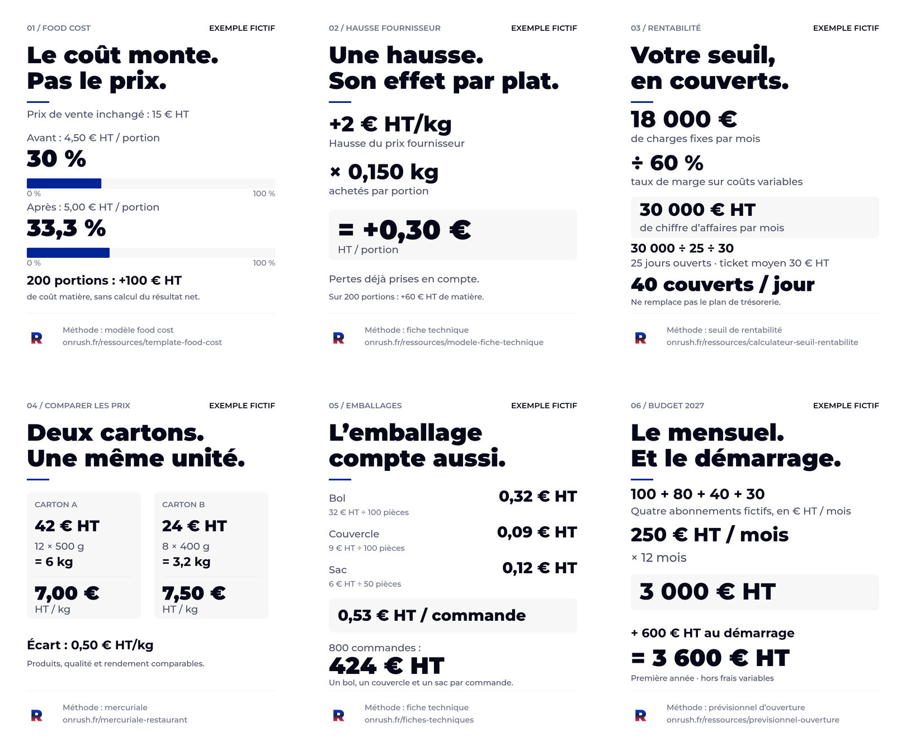

# Six figures pour calculer les coûts d’un restaurant

Coût matière, hausse fournisseur, seuil de rentabilité, conditionnements, emballages et budget d’ouverture : six exemples pour comprendre les calculs et leurs unités.

Les **PNG mesurent 1080 × 1350 pixels**, au format RGB sRGB. Les SVG conservent les textes éditables et les PDF comportent une page chacun.

**Tous les exemples sont fictifs.** Ils ne présentent ni des résultats clients ni des tarifs d’éditeurs. Les montants sont HT lorsque précisé ; les charges fixes du troisième exemple sont mensuelles. Un coût matière ou un seuil de rentabilité ne remplace pas un calcul de résultat net ou un plan de trésorerie.

| Figure et sujet                                    | Image à télécharger                                                              | Texte éditable                                                                   | Impression                                                                       |
| -------------------------------------------------- | -------------------------------------------------------------------------------- | -------------------------------------------------------------------------------- | -------------------------------------------------------------------------------- |
| LI01 — Food cost : 30 % puis 33,3 %                | [PNG](https://cyrilquesnel.github.io/onrush-food-cost/visuels-linkedin/LI01.png) | [SVG](https://cyrilquesnel.github.io/onrush-food-cost/visuels-linkedin/LI01.svg) | [PDF](https://cyrilquesnel.github.io/onrush-food-cost/visuels-linkedin/LI01.pdf) |
| LI02 — Hausse fournisseur : +0,30 € HT par portion | [PNG](https://cyrilquesnel.github.io/onrush-food-cost/visuels-linkedin/LI02.png) | [SVG](https://cyrilquesnel.github.io/onrush-food-cost/visuels-linkedin/LI02.svg) | [PDF](https://cyrilquesnel.github.io/onrush-food-cost/visuels-linkedin/LI02.pdf) |
| LI03 — Seuil : 40 couverts par jour                | [PNG](https://cyrilquesnel.github.io/onrush-food-cost/visuels-linkedin/LI03.png) | [SVG](https://cyrilquesnel.github.io/onrush-food-cost/visuels-linkedin/LI03.svg) | [PDF](https://cyrilquesnel.github.io/onrush-food-cost/visuels-linkedin/LI03.pdf) |
| LI04 — Conditionnements : comparer au kilo         | [PNG](https://cyrilquesnel.github.io/onrush-food-cost/visuels-linkedin/LI04.png) | [SVG](https://cyrilquesnel.github.io/onrush-food-cost/visuels-linkedin/LI04.svg) | [PDF](https://cyrilquesnel.github.io/onrush-food-cost/visuels-linkedin/LI04.pdf) |
| LI05 — Emballages : calculer à la pièce            | [PNG](https://cyrilquesnel.github.io/onrush-food-cost/visuels-linkedin/LI05.png) | [SVG](https://cyrilquesnel.github.io/onrush-food-cost/visuels-linkedin/LI05.svg) | [PDF](https://cyrilquesnel.github.io/onrush-food-cost/visuels-linkedin/LI05.pdf) |
| LI06 — Budget fictif de première année             | [PNG](https://cyrilquesnel.github.io/onrush-food-cost/visuels-linkedin/LI06.png) | [SVG](https://cyrilquesnel.github.io/onrush-food-cost/visuels-linkedin/LI06.svg) | [PDF](https://cyrilquesnel.github.io/onrush-food-cost/visuels-linkedin/LI06.pdf) |

## Calculs présentés

- **LI01** : 4,50 ÷ 15 × 100 = 30 % ; 5 ÷ 15 × 100 = 33,3 % arrondis. Sur 200 portions, le surcoût matière est de 100 € HT.
- **LI02** : +2 € HT/kg × 0,150 kg achetés = +0,30 € HT/portion, soit 60 € HT sur 200 portions. Les pertes sont déjà prises en compte dans la quantité achetée.
- **LI03** : 18 000 € de charges fixes mensuelles ÷ 60 % de taux de marge sur coûts variables = 30 000 € HT de chiffre d’affaires mensuel ; 30 000 ÷ 25 jours ÷ 30 € HT par couvert = 40 couverts/jour.
- **LI04** : 42 € HT ÷ 6 kg = 7 € HT/kg ; 24 € HT ÷ 3,2 kg = 7,50 € HT/kg, pour un produit, une qualité et un rendement comparables.
- **LI05** : 0,32 + 0,09 + 0,12 = 0,53 € HT par commande ; 800 commandes représentent 424 € HT.
- **LI06** : 250 € HT/mois × 12 + 600 € HT au démarrage = 3 600 € HT la première année, hors frais variables. Ce budget ne représente aucun tarif d’éditeur.

## Identité et droits

Figures proposées par **Onrush**, édité par **SAS La Fabrique Alimentaire**. Les ressources de méthode sont indiquées sur chaque figure.

La marque et l’icône officielle Onrush restent exclues de la licence MIT du code et ne sont pas redessinées. La police Montserrat intégrée aux SVG relève de la [SIL Open Font License 1.1](MONTSERRAT-OFL.txt). La [licence du projet](https://github.com/Cyrilquesnel/onrush-food-cost/blob/main/LICENSE) et les [notices de droits](https://github.com/Cyrilquesnel/onrush-food-cost/blob/main/THIRD-PARTY-NOTICES.md) conservent leur périmètre ; aucune licence supplémentaire n’est introduite ici.
